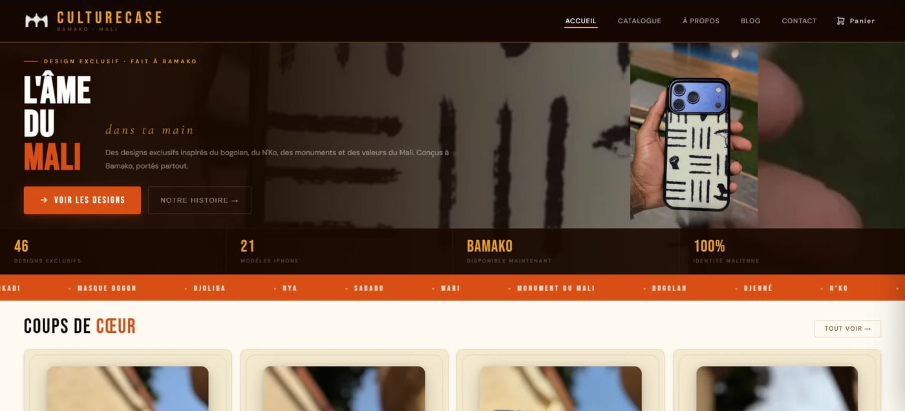

# CultureCase — boutique en ligne

**La boutique en ligne de CultureCase, marque de coques iPhone aux motifs culturels maliens** (bogolan, N'Ko, masques dogon, monuments du Mali…), conçue à Bamako.

## Ce que fait le site

- **Catalogue** des designs, avec fiche détaillée par design et choix du modèle d'iPhone, prix et stock en temps réel.
- **Panier et commande** : les commandes sont envoyées au back-office **CultureCase GS**, où elles sont validées avant d'être traitées.
- **Suivi de commande** et page « Mes commandes » pour retrouver les commandes passées depuis l'appareil.
- **Avis clients** : soumis depuis le site, publiés après modération.
- **Blog**, page « Notre histoire » et contact.

## Comment c'est construit

- **Application monopage en JavaScript vanilla**, sans framework ni étape de build : quelques fichiers statiques, hébergés sur GitHub Pages.
- **Firestore en temps réel** pour le catalogue, les prix, le stock et le blog, partagés avec le back-office.
- **Une seule source de vérité** : le catalogue n'est modifiable que depuis CultureCase GS ; le site ne peut créer que des avis et des commandes **en attente**, que l'équipe valide ensuite.

---

## Développement

### Fichiers

- `index.html` — structure HTML de toutes les pages (SPA à page unique, sections `.pg` activées/désactivées en JS).
- `app.js` — logique applicative : routing, catalogue, panier, fiche produit, blog, commande.
- `firebase-init.js` — connexion Firebase (module ES), listeners temps réel sur Firestore, panier/avis.
- `style.css` — feuille de style globale.

### Lancer en local

Site 100% statique : servir le dossier avec n'importe quel serveur HTTP statique (ex. `npx serve .`) et ouvrir `index.html`. Pas de build, pas de dépendances npm.

### Intégration avec CultureCase GS

Le site lit le catalogue/stock/blog depuis le back-office CultureCase GS sur les collections Firestore du projet `culturecase-gs`, et écrit deux types de contenu soumis par les visiteurs, à valider côté GS :

| Collection Firestore | Sens | Contenu |
|---|---|---|
| `data/main` + `data/products_*` (chunked) | lecture | catalogue, stock, prix (`priceSettings.modelPrices`), designs |
| `blog_posts` | lecture | articles de blog (gérés depuis GS) |
| `reviews` (statut `published`) | lecture | avis clients validés, affichés sur le site |
| `reviews` (statut `pending`) | **écriture** | nouveaux avis soumis via le formulaire du site, en attente de modération côté GS |
| `webOrders` (statut `pending`) | **écriture** | commandes passées sur le site, à valider côté GS |

Le catalogue, les prix et le blog ne sont modifiables que côté GS. Les avis et les commandes peuvent être créés depuis le site, mais restent en attente (`pending`) tant qu'ils ne sont pas validés côté GS.

---

## Auteur

Conçu et développé par **[Mohamed Solomani Doumbia](https://viem0s.github.io/)** pour ABC STUDY — Bamako, Mali.
[Portfolio](https://viem0s.github.io/) · [E-mail](mailto:dmohamedsolomani@gmail.com) · [WhatsApp](https://wa.me/22375992482)
